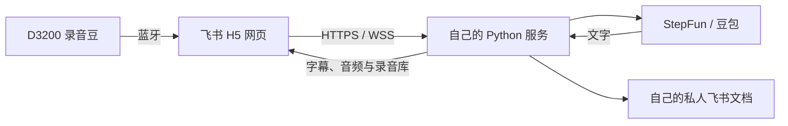

# 录音豆 · luyindou

把 Soundcore D3200 录音豆接入自己的飞书网页应用：在飞书底部点开「录音豆」，连接设备、看实时字幕，录后播放、搜索、编辑、导出，并生成私人飞书文档。

每位使用者部署自己的服务、创建自己的飞书应用、配置自己的语音服务账号。仓库提供完整源码和操作步骤，不依赖作者的服务器或账号。

**许可：个人学习和个人非商业使用免费；商业使用、企业内部业务部署及为组织提供服务，须事先取得另行书面授权。** 详见 [LICENSE](LICENSE)。

## 从这里开始

1. [从零部署：账号、飞书应用、服务器与 HTTPS](docs/SETUP.md)
2. [把「录音豆」固定到飞书底部导航栏](docs/NAVIGATION.md)
3. [连接、录音、转写和验收](docs/USAGE.md)
4. [本地开发、测试和代码目录](docs/DEVELOPMENT.md)
5. [常见问题](docs/TROUBLESHOOTING.md) · [数据与隐私](SECURITY.md) · [发行版验证范围](docs/VALIDATION.md)

## 能做什么

| 环节 | 当前实现 |
| --- | --- |
| 入口 | 飞书工作台应用，可由用户固定到移动端底部导航栏 |
| 登录 | 飞书端内免口令登录，服务端只接受配置的一个账号 |
| 设备 | 蓝牙连接 D3200，显示设备信息、电量、存储和录音状态 |
| 采集 | 按设备实体键录音，网页接收、解密，服务端保存 WAV |
| 实时转写 | StepFun 或豆包；也可先只保存音频，再识别全文 |
| 录后处理 | 全文识别、发言人结果预览和应用、总结、章节、翻译 |
| 录音库 | 保存、重开、播放、倍速、搜索、文字修订、TXT/SRT/WAV 导出 |
| 飞书文档 | 为配置的本人创建私有文档，回读权限后写入正文 |
| 设备文件 | 查看设备文件，用户勾选并确认后删除；此操作不可恢复 |



## 使用前了解

- 这是**飞书内的自建 H5 网页应用**。底部导航栏打开的是这份应用。它不替换官方妙记的原生实时字幕，不修改官方 ASR 额度，也不自动关闭原厂转写。
- 当前产品按**单人私有部署**设计。不要仅扩大飞书可用范围或登录白名单就当作多人版；录音存储还没有按用户隔离。
- 真机经验来自 iPhone 飞书与 D3200；其他系统、型号、固件需要自行验收。Safari 普通网页不等同于飞书容器。
- 实时取音存在发现与握手延迟。在已测固件 04.92 上，开头约 2–4 秒可能没有进入网页；本项目录后识别处理的是服务端已保存音频，不会自动从设备补回这几秒。
- 以设备实体键控制录音开始和结束。网页「停止并保存」只结束接收，设备可能仍在录音。
- 使用语音识别、总结、翻译会调用你配置的服务商；按服务商规则计费。短时后台成功记录不代表 iOS 可无限期后台录音。

## 快速验证源码

需要 Node.js 18+、Python 3.11+ 和 libopus。下列自动测试使用合成音频与本地模拟服务，不需要真实密钥：

```sh
git clone https://github.com/mcncarl/luyindou.git
cd luyindou
python3 -m venv .venv
.venv/bin/python -m pip install -r server/requirements.txt
npm test
.venv/bin/python -m unittest discover -s server -p 'test_*.py'
python3 tools/check_release.py
```

Ubuntu/Debian 可通过 `sudo apt-get install libopus0` 安装解码库，macOS 可用 `brew install opus`。完整安装顺序见部署指南。仓库无需 `npm install`，前端没有在线 npm 依赖。

## 使用许可与商业授权

本项目原创内容采用自定义的[录音豆个人非商业使用许可证 1.0](LICENSE)：

- **免费范围**：个人学习、研究、测试、自行部署及个人日常非商业使用；可在保留许可证、版权声明并标注修改的条件下，为非商业学习交流免费分享。
- **须另行授权**：企业内部业务使用、商业产品集成、托管/SaaS/API、收费代部署、定制交付、商业转售，以及为雇主或客户开展业务。修改代码或不直接收费，不会自动免除授权要求。
- **申请方式**：通过[维护者 GitHub 主页](https://github.com/mcncarl)所列联系渠道申请，说明使用主体、用途、部署方式和规模；授权范围与费用以另行书面协议为准。

这是限制商业用途的源码可用许可，不属于 OSI 定义的开源许可证。以上说明是便于阅读的摘要，具体权利义务以 [LICENSE](LICENSE) 为准。第三方依赖继续遵循各自原有许可证，协议参考和图形来源见 [THIRD_PARTY.md](THIRD_PARTY.md)。
